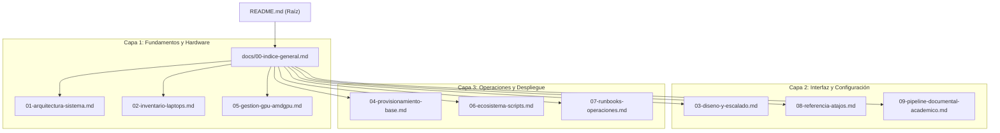

# 00 — Catálogo Maestro de Documentación Técnica (Docs-as-Code)

Este documento constituye el índice general y catálogo maestro de la biblioteca documental de **Desktop Infrastructure as Code (Desktop IaC)** para la gestión declarativa de las estaciones de trabajo de Jorge.

Toda la documentación está redactada bajo el estándar **Docs-as-Code**, empleando una **taxonomía jerárquica numérica (`01-`, `02-...`)**, rutas relativas dinámicas para portabilidad absoluta, y diagramas técnicos Mermaid.

---

## 1. Mapa de la Biblioteca Documental

| Código | Documento Técnico | Dominio de Ingeniería | Descripción del Contenido |
| :---: | :--- | :--- | :--- |
| **`01`** | **[01. Arquitectura del Sistema](01-arquitectura-sistema.md)** | Arquitectura y Diseño | Modelo híbrido en 3 capas (Debian base + Nix Flakes Home Manager Standalone + Flatpak), flujo de evaluación hermético, auto-descubrimiento dinámico de hosts, integración continua (CI) y aislamiento FUSE/VFS. |
| **`02`** | **[02. Inventario de Laptops](02-inventario-laptops.md)** | Hardware y Perfiles | Perfiles técnicos de hardware (`jorge-terciaria` y `jorge-secundaria`), resoluciones nativas (1080p vs 768p), calibración de touchpads, atajos de pantalla rota y esquema de workspaces. |
| **`03`** | **[03. Diseño y Escalado](03-diseno-y-escalado.md)** | UI/UX y Sistema de Diseño | Sistema de escalado tipográfico `mySystem`, solución al remuestreo borroso en Wayland, arquitectura declarativa centralizada de Waybar (`mySystem.waybarConfig`), Rofi y navegadores web. |
| **`04`** | **[04. Aprovisionamiento Base](04-provisionamiento-base.md)** | SysAdmin y Sistema Operativo | Script idempotente `setup/instalar.sh`, provisión de 8 GB de swap en `/home/swapfile`, desacoplamiento de Docker en `/home/docker`, detección condicional de hardware (Dell/AMD), TLP, GRUB silencioso y SDDM. |
| **`05`** | **[05. Gestión de GPU AMD](05-gestion-gpu-amdgpu.md)** | Kernel y Gráficos | Control dinámico DPM en `sysfs` (`low` vs `auto`), reglas udev, servicio `amdgpu-powersave`, detección condicional en `lspci` y atajos de teclado para alternar rendimiento. |
| **`06`** | **[06. Ecosistema de Scripts](06-ecosistema-scripts.md)** | Automatización y Utilidades | Stack de dictado por voz offline (VOXD + Whisper), disco virtual Google Drive FUSE aislado en subdirectorio XDG (`~/.local/share/gdrive`), gestor `sincro`, rotación de pantalla (`hypr-rotate`) y wrapper `./switch`. |
| **`07`** | **[07. Runbooks Operativos](07-runbooks-operaciones.md)** | Operaciones y DevOps | Procedimientos estándar (SOP): aprovisionamiento de laptops desde cero, adición desatendida de nuevos hosts, flujo diario de sincronización GitOps y ciclo de parches de seguridad (Node.js CVEs). |
| **`08`** | **[08. Referencia de Atajos](08-referencia-atajos.md)** | Ergonomía y Keybindings | Catálogo exhaustivo y categorizado de atajos de teclado en Hyprland: lanzadores principales (`Super + A/B/C/E/M/O/T`), gestión de ventanas, mosaicos, medios, capturas y sesión. |
| **`09`** | **[09. Pipeline Académico](09-pipeline-documental-academico.md)** | IA e Integración Académica | Modelo bicanal de producción académica universitaria (UBE): canal formal APA 7 (`rubric-driven` + `python-docx`) y canal técnico tipográfico (`typst`), respaldos Obsidian y sincronización en la nube. |

---

## 2. Puntos de Entrada y Relaciones del Sistema

---

## 3. Navegación Rápida hacia la Raíz

* Para consultar la guía de inicio rápido y comandos esenciales de terminal: **[Volver al README principal](../README.md)**.
