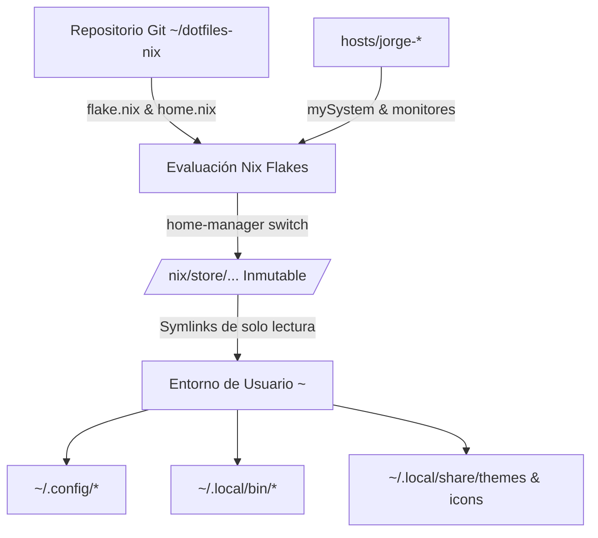
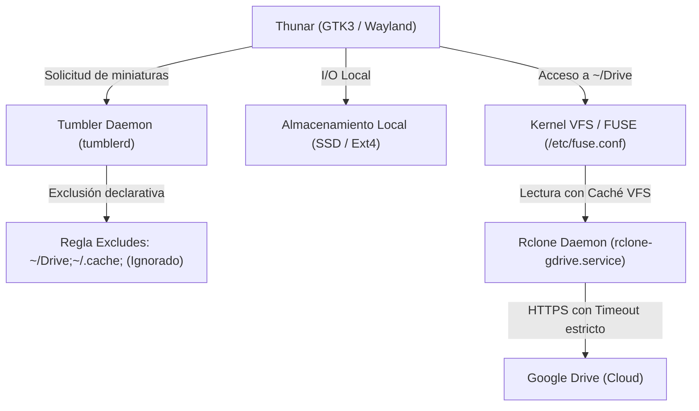

# 01 — Arquitectura del Sistema (Desktop IaC)

## 1. Filosofía de Ingeniería: Desktop Infrastructure as Code (Desktop IaC)

Este repositorio traslada los principios de la ingeniería de infraestructura en la nube (**IaC**, **GitOps**, **Idempotencia** e **Inmutabilidad**) a la gestión de estaciones de trabajo personales (laptops).

El objetivo es erradicar por completo el **desvío de configuración (*Configuration Drift*)**:
* Ningún cambio estético, de paquetes o de comportamiento se realiza directamente mediante clics o comandos manuales no reproducibles.
* La configuración completa reside en Git como fuente única de verdad (*Single Source of Truth*).
* Los archivos resultantes generados en el directorio de usuario (`~/.config/`, `~/.local/bin/`, etc.) son enlaces simbólicos de solo lectura que apuntan directamente a entradas criptográficamente verificadas dentro del **Nix Store** (`/nix/store/`).



---

## 2. Modelo Híbrido: Debian GNU/Linux + Nix Flakes Standalone

Una de las decisiones arquitectónicas más importantes de este entorno es el uso de **Home Manager en modo Standalone sobre Debian GNU/Linux**, en lugar de utilizar NixOS puro.

### Separación de Responsabilidades (*Separation of Concerns*)

| Capa | Administrador | Responsabilidad Técnica | Razón de Ingeniería |
| :--- | :--- | :--- | :--- |
| **Capa 1: Sistema Base** | Debian (`apt` + `/etc/`) | Kernel Linux, Firmware/DRM, controladores gráficos Mesa/AMDGPU, PipeWire, compositor Hyprland base, Display Manager SDDM (módulos Qt6), autenticación PAM (`/etc/pam.d/hyprlock` para `hyprlock`/`hypridle`), almacenamiento de sistema/FUSE (`gvfs`, `gvfs-fuse`, `thunar`, `tumbler`), TLP y aplicaciones nativas aceleradas (`brave-browser`, `zoom`). | Enlace 100% nativo con librerías dinámicas del sistema (`radeonsi_dri.so`, `libEGL.so`), aceleración por hardware por GPU sin wrappers ni desajustes de ABI, y gestión de seguridad privilegiada en PAM que no puede ser gobernada por gestores de paquetes no privilegiados de usuario. |
| **Capa 2: Entorno Declarativo** | Nix Flakes + Home Manager | Herramientas CLI (Neovim, Yazi, Fastfetch, LSD, Rclone, Linters/Formatters), monitor `btop`, entorno visual de sesión (Waybar, Rofi, SwayNC, SwayOSD, Hyprshell), temas GTK/Qt, cursores, fuentes, scripts en `~/.local/bin/` y dotfiles inmutables en `/nix/store/` (incluyendo `hyprlock.conf` e `hypridle.conf`). | Entorno reproducible, versionado, aislado de dependencias de Debian y con posibilidad de rollback instantáneo sin romper el sistema operativo. Se evita instalar paquetes que colisionen con PAM del host. |
| **Capa 3: Aplicaciones GUI Aisladas** | Flatpak (`flathub`) | Clientes de mensajería (ZapZap / WhatsApp), multimedia y aplicaciones de terceros con interfaces web o QtWebEngine complejas. | Provee runtimes y drivers Mesa autocontenidos que operan directamente sobre el subsistema DRM del kernel, eliminando rupturas de enlaces dinámicos (ABI) que ocurren al ejecutar aplicaciones gráficas pesadas dentro de Nix Standalone sobre Debian. |

### Por qué esta separación es superior en laptops de producción:
1. **Estabilidad Gráfica en Wayland:** Compositor Wayland (Hyprland) y navegadores (Brave/Chromium) se comunican directamente con el subsistema gráfico del kernel y Mesa sin desajustes de versiones de drivers.
2. **Portabilidad Multi-Distribución:** Si una laptop futura utiliza Arch Linux, Fedora u otra distro, la capa de usuario de Nix se despliega de forma idéntica sin modificar la lógica declarativa.

---

## 3. La Dupla Técnica: Nix Flakes + Home Manager

La arquitectura se sustenta en dos herramientas complementarias que resuelven dos problemas distintos:

### ¿Qué hace Nix Flakes? (Capa de Reproducibilidad e Integridad)
* **Bloqueo Criptográfico de Dependencias:** A través de [flake.lock](../flake.lock), fija los hashes exactos de los canales de `nixpkgs` y `home-manager`. Ambas laptops compilan y descargan exactamente las mismas versiones de paquetes sin variación temporal.
* **Hermetismo y Cero Efectos Secundarios:** Las evaluaciones no dependen de variables de entorno globales del sistema ni de canales imperativos (`nix-channel`), eliminando el problema clásico de *"en mi máquina sí funciona"*.
* **Definición de Entradas y Salidas Estructuradas:** Expone formalmente la función `outputs` donde se declaran las configuraciones de cada laptop (`jorge@jorge-terciaria`, `jorge@jorge-secundaria`).

### ¿Qué hace Home Manager? (Capa de Gestión del Entorno de Usuario)
* **Orquestación de `$HOME`:** Transforma las expresiones Nix en archivos reales dentro de `/nix/store/` y crea los enlaces simbólicos de solo lectura hacia `~/.config/`, `~/.local/share/` y `~/.local/bin/`.
* **Servicios de Usuario Systemd:** Levanta y supervisa automáticamente los daemons de usuario como `swaync`, `swayosd`, `wlsunset` y `hyprshell` vinculados a `graphical-session.target`.
* **Inyección de Variables de Sesión:** Exporta de manera declarativa variables críticas para Wayland (`XDG_SESSION_TYPE`, `GTK_THEME`, `XCURSOR_SIZE`, etc.) sin ensuciar manualmente `.bashrc` o `/etc/environment`.
* **Aislamiento Multi-Host:** Permite inyectar los parámetros de hardware específicos de cada laptop (`hosts/jorge-*`) sobre una base común compartida ([home.nix](../home.nix)).

---

## 4. Estructura y Flujo de Evaluación de Nix

El punto de entrada del sistema es [flake.nix](../flake.nix):

1. **`inputs`:**
   * `nixpkgs`: Canal `nixos-unstable` para disponer del software más moderno.
   * `home-manager`: Rama sincronizada que sigue a `nixpkgs` para garantizar compatibilidad binaria de librerías.
2. **`outputs`:**
   * **Auto-descubrimiento dinámico de hosts:** En lugar de declarar targets manualmente, [flake.nix](../flake.nix) escanea recursivamente el directorio `./hosts/` mediante `builtins.readDir` y genera automáticamente la configuración `"jorge@<hostname>"` para cualquier nuevo subdirectorio creado.
   * Expone formalmente `homeConfigurations`:
     * `"jorge@jorge-terciaria"`: Mapea a [home.nix](../home.nix) + [hosts/jorge-terciaria](../hosts/jorge-terciaria).
     * `"jorge@jorge-secundaria"`: Mapea a [home.nix](../home.nix) + [hosts/jorge-secundaria](../hosts/jorge-secundaria).
     * `"jorge"`: Alias de conveniencia retrocompatible.
   * **Script Operativo de Despliegue ([switch](../switch)):** Wrapper que resuelve dinámicamente `$(hostname)`, valida la existencia del perfil en `hosts/` y ejecuta `home-manager switch --flake .#jorge@<hostname>`.
   * **Validación Continua (CI):** Pipeline en `.github/workflows/ci.yml` que valida la integridad de todos los perfiles de la flota con `nix flake check` en cada commit.
3. **Módulos (`modules/`):**
   * [home.nix](../home.nix) orquesta la importación modular de:
     * `style.nix`: Motor de temas, fuentes y opciones tipadas `mySystem`.
     * `desktop.nix`: Componentes de escritorio, servicios de usuario systemd y Waybar.
     * `apps.nix`: Terminal Alacritty tipado, navegadores, flags de aceleración y utilidades.
     * `shell.nix`: Zsh, Starship prompt, FZF personalizado y Git.
     * `scripts.nix`: Enlace declarativo de ejecutables a `~/.local/bin/`.

---

## 5. Subsistema de Archivos, VFS y Aislamiento FUSE

La exploración de archivos y el montaje de unidades virtuales combinan la base de Debian y Home Manager bajo un diseño estrictamente defensivo para erradicar cuelgues de la interfaz gráfica:



### Principios de Aislamiento
1. **Aislamiento de Miniaturas ([raw_configs/tumbler/tumbler.rc](../raw_configs/tumbler/tumbler.rc)):**
   * Enlazado declarativamente a `~/.config/tumbler/tumbler.rc`.
   * Define formalmente `Excludes=~/Drive;~/.cache;` y tope `MaxFileSize=52428800` (50 MB) en todos los generadores. Impide que `tumblerd` intente descargar o procesar archivos masivos a través del montaje FUSE, protegiendo el bus D-Bus de saturación.
2. **Políticas Inmutables en Thunar ([raw_configs/xfce4/.../thunar.xml](../raw_configs/xfce4/xfconf/xfce-perchannel-xml/thunar.xml)):**
   * Gestionado por Home Manager mediante canal Xfconf.
   * Fija `misc-thumbnail-mode` en `THUNAR_THUMBNAIL_MODE_ONLY_LOCAL` y `misc-parallel-copy-mode` en `THUNAR_PARALLEL_COPY_MODE_ALWAYS`.
3. **Resiliencia en el Montaje FUSE de Rclone ([modules/apps.nix](../modules/apps.nix)):**
   * Vinculado a `graphical-session.target` (eliminando la dependencia inexistente `network-online.target` en el gestor de usuario).
   * Banderas críticas: `--attr-timeout 10m` y `--dir-cache-time 24h` (eliminan llamadas remotas `stat()` redundantes), `--poll-interval 1m` (notificaciones asíncronas de cambios), `--vfs-disk-space-total-size 5T` (emulación estática de espacio que previene congelamiento en `statfs()`), `--timeout 30s` y `--contimeout 10s` (corte estricto de sockets para prevenir procesos en estado D no interrumpible ante fallos de red).
4. **Aislamiento FUSE contra Sondeos de Discos GVFS ([modules/apps.nix](../modules/apps.nix)):**
   * El sistema FUSE se monta en `~/.local/share/gdrive` y se expone como enlace simbólico transparente en `~/Drive`.
   * Motivo técnico: La regla nativa de GVFS (`g_strstr_len(mount_path, -1, "/.") != NULL`) ignora automáticamente cualquier montaje en subdirectorios ocultos. Esto impide que `gvfs-udisks2-volume-monitor` lo catalogue como unidad extraíble y envíe sondeos síncronos de red (`autorun.inf`, `bdmv`, `xdg_volume_info`) al arrancar exploradores en frío como Thunar, eliminando de raíz el timeout de 25 segundos de D-Bus.

---

## 6. Resolución Declarativa de Tipos MIME y Protocolos URL

El despacho de enlaces web y protocolos personalizados (`zoommtg://`, `zoomus://`, `whatsapp://`, `mailto://`) se gobierna mediante la especificación oficial de **FreeDesktop XDG MIME**:

1. **Preferencia Primaria Declarativa ([raw_configs/mimeapps.list](../raw_configs/mimeapps.list)):**
   * Enlazado a `~/.config/mimeapps.list` por Home Manager.
   * La biblioteca GLib/GIO y los portales Wayland (`xdg-desktop-portal-gtk` vía OpenURI) consultan primero este archivo. Al definir explícitamente los mapeos:
     ```ini
     [Default Applications]
     x-scheme-handler/zoommtg=Zoom.desktop
     x-scheme-handler/zoomus=Zoom.desktop
     x-scheme-handler/whatsapp=com.rtosta.zapzap.desktop
     ```
   * Se elimina la necesidad de herramientas auxiliares o reconstrucciones de caché `mimeinfo.cache`, resolviendo los lanzadores de forma instantánea sin mostrar cuadros de error de aplicaciones no disponibles.

---

## 7. Ciclo de Vida de Seguridad y Gestión Criptográfica de Parches

La gestión de parches para vulnerabilidades críticas (como fallos RCE o denegación de servicio en runtimes) aprovecha el determinismo de **Nix Flakes**:

1. **Bloqueo Inmutable de Versiones ([flake.lock](../flake.lock)):**
   * Cada herramienta del entorno de desarrollo (Node.js, Neovim, linters, compiladores) está fijada a un hash SHA-256 exacto. Ningún commit o compilación introduce cambios flotantes sin consentimiento.
2. **Mitigación Quirúrgica de Vulnerabilidades:**
   * Ante alertas de seguridad críticas (ejemplo: `CVE-2026-111497` de ejecución remota de código en el decodificador Brotli de Node.js 22.x), la remediación se ejecuta actualizando el input de Nixpkgs (`nix flake update nixpkgs`).
   * Nix descarga la versión mitigada (`v22.23.4`) directamente de la caché binaria oficial (`cache.nixos.org`), reemplazando el runtime en `/nix/store/` sin tocar el gestor de paquetes del sistema operativo base (Debian).
3. **Distribución Cero-Drift a la Flota:**
   * Al hacer commit de `flake.lock` y sincronizarlo mediante Git, cualquier laptop de la flota que ejecute `git pull && ./switch` recibe exactamente el mismo binario validado criptográficamente, erradicando discrepancias entre equipos de trabajo.
