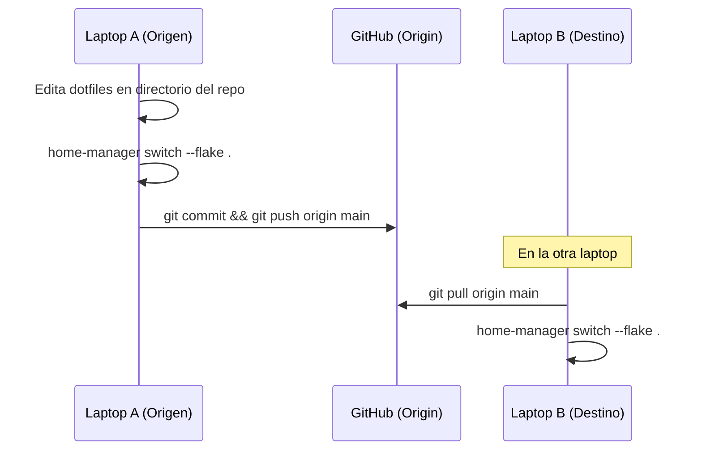

# 07 — Runbooks y Procedimientos Operativos (SOP)

Este documento contiene los manuales de procedimiento estándar (*Standard Operating Procedures*) para la administración de las laptops.

---

## Runbook 1: Aprovisionamiento de una Laptop desde Cero

Sigue estos pasos en una máquina recién formateada con Debian GNU/Linux:

### Paso 1: Asignar Hostname y Resolución Local
Identifica si la máquina será `jorge-secundaria`, `jorge-terciaria` o un nuevo host:
```bash
# Ejemplo para jorge-secundaria:
sudo hostnamectl set-hostname jorge-secundaria
sudo sed -i 's/127.0.1.1.*/127.0.1.1\tjorge-secundaria/' /etc/hosts
```

### Paso 2: Clonar Repositorio y Aprovisionar Sistema Base
```bash
DOTFILES_DIR="${DOTFILES_DIR:-$HOME/dotfiles-nix}"
git clone https://github.com/JorgeDoicela/dotfiles-nix.git "$DOTFILES_DIR"
cd "$DOTFILES_DIR"
sudo bash ./setup/instalar.sh
```
*Este paso configurará repositorios, llaves GPG, TLP para batería, GRUB silencioso, servicios de GPU AMD y paquetes base.*

### Paso 3: Instalar Nix (Determinate Systems Installer)
Ejecuta el instalador oficial recomendado:
```bash
sh <(curl -L https://install.determinate.systems/nix) install
```
*Cierra y reabre tu terminal o ejecuta `source /nix/var/nix/profiles/default/etc/profile.d/nix-daemon.sh` para cargar las variables.*

### Paso 4: Desplegar el Perfil Declarativo de Home Manager
```bash
# Desde el directorio del repositorio:
# Para la laptop jorge-secundaria:
nix run github:nix-community/home-manager -- switch --flake .#jorge@jorge-secundaria

# Para la laptop jorge-terciaria:
nix run github:nix-community/home-manager -- switch --flake .#jorge@jorge-terciaria
```

---

## Runbook 2: Agregar una Nueva Laptop al Repositorio

Si incorporas un nuevo equipo (por ejemplo, `jorge-cuarta`):

1. **Crear la estructura del host:**
   ```bash
   mkdir -p hosts/jorge-cuarta
   ```
2. **Definir la configuración del host ([hosts/jorge-cuarta/default.nix](../hosts)):**
   ```nix
   { config, pkgs, ... }:
   {
     mySystem = {
       fontSize = 11;
       cursorSize = 24;
       waybarFontSize = "13px";
       rofiFontSize = "10";
       rofiWidth = "600px";
       rofiHeight = "350px";
       browserScale = "1";
     };

     xdg.configFile."hypr/monitors.conf".source = ./monitors.conf;
     xdg.configFile."waybar/config.json".source = ./config.json;
   }
   ```
3. **Crear `monitors.conf` y `config.json`:**
   Configura la resolución nativa de la pantalla interna y el estilo de la barra Waybar según las características del nuevo equipo.
4. **Registrar el host en [flake.nix](../flake.nix):**
   ```nix
   "jorge@jorge-cuarta" = home-manager.lib.homeManagerConfiguration {
     inherit pkgs;
     modules = [
       ./home.nix
       ./hosts/jorge-cuarta
     ];
   };
   ```
5. **Verificar que la sintaxis sea correcta:**
   ```bash
   nix flake check .
   ```

---

## Runbook 3: Flujo Diario de Sincronización GitOps

Para mantener todas las laptops sincronizadas y evitar derivas de configuración:



1. Realiza los cambios en tu laptop actual.
2. Aplica y prueba localmente desde el repositorio con:
   ```bash
   home-manager switch --flake .
   ```
3. Sube los cambios a Git:
   ```bash
   git add .
   git commit -m "feat(modulo): descripcion concisa del cambio"
   git push origin main
   ```
4. En tus demás laptops, simplemente ejecuta desde el repositorio:
   ```bash
   git pull origin main
   home-manager switch --flake .
   ```
   *Home Manager recargará automáticamente los servicios de usuario de systemd (como `rclone-gdrive.service`). Para verificar el estado:*
   ```bash
   systemctl --user status rclone-gdrive.service
   ls -la ~/Drive
   ```
   *Si deseas sincronizar tus carpetas locales offline (ej. Obsidian):*
   ```bash
   sincro
   ```

---

## Runbook 4: Rollback y Limpieza del Nix Store

### Revertir a una Generación Anterior (Rollback)
Si un cambio introducido rompe algún componente visual o funcionalidad:
```bash
# Listar las generaciones anteriores registradas:
home-manager generations

# Activar una generación específica anterior:
/nix/store/<hash>-home-manager-generation/activate
```

### Liberar Espacio en Disco (Garbage Collection)
Con el tiempo, el Nix Store retiene paquetes de generaciones anteriores. Para eliminarlos y recuperar espacio:
```bash
# Eliminar generaciones anteriores y limpiar paquetes huérfanos:
nix-collect-garbage -d
```

---

## Runbook 5: Vinculación Multidispositivo de la Bóveda Obsidian en GitHub Privado

Este runbook detalla el procedimiento para enlazar una laptop secundaria o nuevo equipo a la bóveda privada versionada en GitHub (`git@github.com:JorgeDoicela/vida_de_jorge.git`).

### 1. Modelo de Redundancia y Aislamiento Dual
* **Capa Activa (Sincronización en Caliente):**
  * **Linux:** Sincronización continua y bidireccional mediante `sincro` (Rclone Bisync). Excluye estrictamente `.git/**` mediante [sincro-filters.txt](../raw_configs/rclone/sincro-filters.txt).
  * **Windows:** Sincronización mediante Google Drive for Desktop enlazado localmente con puntos de unión NTFS (*Junction Points*).
  * **Android:** Sincronización bidireccional mediante FolderSync con exclusión de `.obsidian/workspace*.json` y `.git/**`.
* **Capa Histórica (GitHub Privado):** Respaldo versionado bajo demanda de hitos de estudio o notas consolidadas en `git@github.com:JorgeDoicela/vida_de_jorge.git`.
* **Regla de Operación:** Queda prohibido el uso de plugins de Git con temporizadores automáticos en segundo plano (como `obsidian-git`). Los respaldos Git se realizan manualmente bajo demanda al concluir sesiones de trabajo para evitar bloqueos de archivos (`.git/index.lock`) o duplicados concurrentes.

---

### 2. Procedimiento de Vinculación en Linux (Debian + Sincro)

Ejecuta estos pasos una sola vez en cualquier laptop secundaria una vez que `sincro obsidian` haya descargado las notas de Google Drive:

#### Paso 1: Navegar a la bóveda local
```bash
cd "/home/jorge/Documentos/Vida de Jorge"
```

#### Paso 2: Inicializar el repositorio y registrar el remoto oficial
```bash
# Inicializar repositorio en rama 'main':
git init -b main

# Enlazar el repositorio privado remoto via SSH:
git remote add origin git@github.com:JorgeDoicela/vida_de_jorge.git
```

#### Paso 3: Sincronizar el árbol de trabajo sin alterar notas locales
```bash
# Descargar el historial remoto sin tocar archivos en disco:
git fetch origin

# Alinear el puntero local HEAD al último commit remoto:
git reset --mixed origin/main
```

> [!NOTE]
> `git reset --mixed origin/main` indexa los archivos de trabajo locales contra el commit más reciente de GitHub sin modificar ni eliminar ninguna nota. 

#### Paso 4: Comprobación de integridad
```bash
git status
```
La salida debe confirmar el árbol limpio:
```text
En la rama main
Tu rama está actualizada con 'origin/main'.

nada para hacer commit, el árbol de trabajo está limpio
```

---

### 3. Procedimiento de Vinculación en Windows (Google Drive Desktop Directo)

En estaciones de trabajo Windows, Google Drive for Desktop opera sobre la unidad virtual `G:`. Se opera de forma directa y nativa sobre dicha unidad sin requerir duplicación de almacenamiento ni enlaces intermedios.

#### Paso 1: Verificar disponibilidad sin conexión en Google Drive
1. En las preferencias de Google Drive para ordenadores, asegurar el modo **Transmitir archivos (Stream files)** (asigna la unidad `G:`).
2. En el explorador, navegar a `G:\Mi unidad\Documents\`.
3. Clic derecho sobre `Vida de Jorge` > **Acceso sin conexión** > **Disponible sin conexión**.

#### Paso 2: Inicializar Git y vincular remoto oficial en PowerShell
Abre PowerShell y ejecuta:
```powershell
cd "G:\Mi unidad\Documents\Vida de Jorge"

# Inicializar repositorio en rama main:
git init -b main

# Enlazar origen remoto vía HTTPS (utiliza Git Credential Manager de Windows):
git remote add origin https://github.com/JorgeDoicela/vida_de_jorge.git

# Descargar historial remoto:
git fetch origin

# Alinear el HEAD local al commit remoto sin alterar notas en disco:
git reset --mixed origin/main

# Configurar seguimiento de rama:
git branch --set-upstream-to=origin/main main
```

#### Paso 3: Verificación de exclusiones
Comprobar que `git status` no reporte archivos efímeros de interfaz:
```powershell
git status
```
*El archivo `.gitignore` raíz garantiza que `.obsidian/workspace*.json`, `.obsidian/workspace-mobile.json`, `.obsidian/cache/`, `.trash/`, `desktop.ini` y `Thumbs.db` permanezcan fuera de control de versiones.*

#### Paso 4 (Opcional): Punto de Unión NTFS (*Junction Point*)
Si prefieres que la carpeta aparezca visualmente listada dentro de tu biblioteca personal de `Documentos` en `C:`, puedes crear un punto de unión NTFS:
```powershell
New-Item -ItemType Junction -Path "C:\Users\$env:USERNAME\Documents\Vida de Jorge" -Value "G:\Mi unidad\Documents\Vida de Jorge"
```

#### Paso 5 (Opcional Avanzado): Aislamiento de base de datos con `--separate-git-dir`
Si Google Drive Desktop intenta sincronizar continuamente los binarios en `.git/objects/`, se puede externalizar la base de datos fuera de Drive:
```powershell
git -C "G:\Mi unidad\Documents\Vida de Jorge" init --separate-git-dir="C:\Users\$env:USERNAME\.git-repos\vida_de_jorge.git"
```

---

### 4. Flujo Operativo Posterior
Cualquiera de tus equipos vinculados (Linux o Windows) tiene potestad para sincronizar o respaldar:

* **Para consolidar un respaldo hacia GitHub (Manual / Bajo Demanda):**
  ```bash
  # En Linux:
  cd "/home/jorge/Documentos/Vida de Jorge"
  # En Windows (PowerShell):
  # cd "C:\Users\$env:USERNAME\Documents\Vida de Jorge"

  git add .
  git commit -m "docs: consolidacion de notas"
  git push
  ```

* **Para descargar novedades subidas desde otra máquina:**
  ```bash
  git pull
  ```

---

## Runbook 6: Diagnóstico y Mantenimiento del Explorador de Archivos y Puntos FUSE

Si el gestor de archivos o la interfaz experimentan bloqueos tras desconexiones abruptas de red o suspensión del sistema:

### 1. Auditoría del Estado de Servicios y Procesos
```bash
# Comprobar el estado del montaje FUSE de Google Drive:
systemctl --user status rclone-gdrive.service

# Comprobar los demonios auxiliares de VFS y miniaturas:
ps aux | grep -Ei 'thunar|tumbler|gvfs'
```

### 2. Reinicio Limpio de Demonios VFS
```bash
# Terminar instancias residuales o colgadas:
killall -9 thunar tumblerd 2>/dev/null || true

# Reiniciar el gestor de configuraciones Xfconf para recargar valores declarativos:
systemctl --user restart xfconfd.service 2>/dev/null || pkill xfconfd || true

# Purgar caché de miniaturas fallidas en disco local:
rm -rf ~/.cache/thumbnails/fail/*
```

### 3. Comprobación de Políticas Inmutables en Xfconf
Confirma que las directivas de seguridad locales están activas en tiempo de ejecución:
```bash
xfconf-query -c thunar -p /misc-thumbnail-mode
# Salida esperada: THUNAR_THUMBNAIL_MODE_ONLY_LOCAL
```

